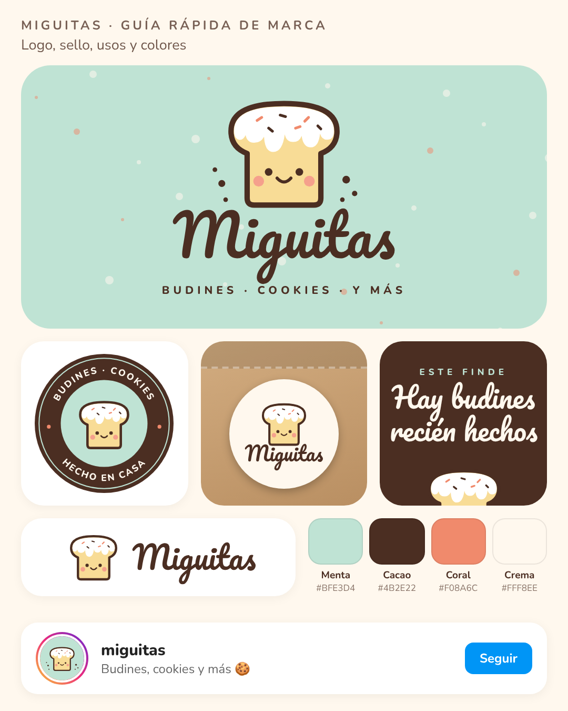

# Miguitas · Marca

Budines, cookies y más. Todo lo necesario para usar la marca en Instagram, stickers y packaging.

## Logos (`logo/`)

Cada logo está en SVG (vectorial, para imprenta) y en PNG con fondo transparente.

| Archivo | Para qué usarlo |
| --- | --- |
| `perfil` | Foto de perfil de Instagram y WhatsApp (cuadrada, fondo menta) |
| `logo-principal` | Logo completo con lema, sobre fondos claros |
| `logo-principal-claro` | Logo completo con lema, sobre fondos oscuros |
| `logo-horizontal` | Encabezados, tarjetas, firmas |
| `sello` | Stickers redondos para moldes y bolsas |
| `mascota` | El budincito solo, para decorar placas e historias |

## Colores

| Color | Código | Uso |
| --- | --- | --- |
| Menta | `#BFE3D4` | Color principal, fondos |
| Cacao | `#4B2E22` | Textos, contornos, fondos oscuros |
| Coral | `#F08A6C` | Acentos y detalles |
| Crema | `#FFF8EE` | Fondos claros |
| Manteca | `#F8DC96` | Cuerpo del budincito |

## Tipografías

Las dos son gratuitas y están en Google Fonts, Canva e Instagram.

- **Pacifico**: nombre de la marca y títulos.
- **Nunito** (700 y 800): textos, lemas en mayúsculas espaciadas y botones.

## Publicaciones (`publicaciones/`)

- `01-budines/`: carrusel de 5 placas (1080×1350) para presentar los budines, con el texto listo en `texto.md`.

## Bio sugerida

> 🍞 Budines, cookies y más
> Hecho en casa, con amor 🤎
> 📩 Pedidos por DM
